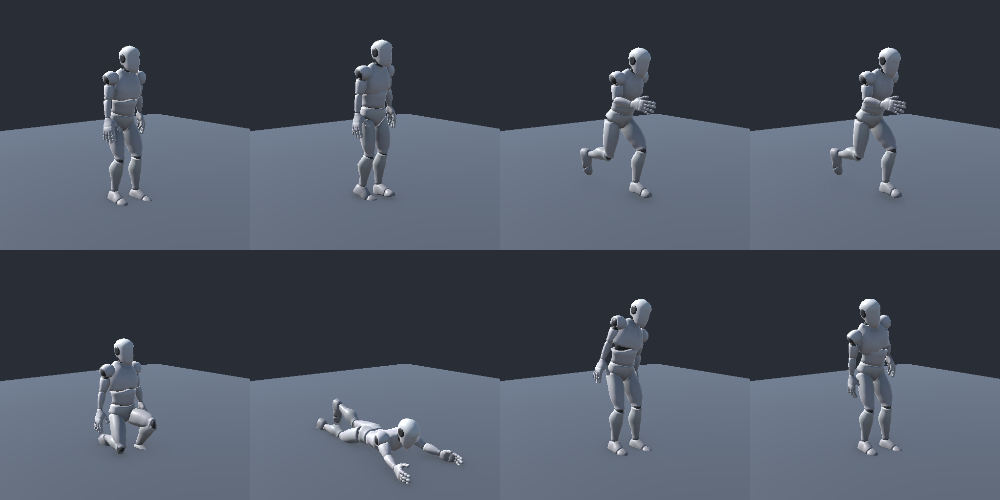

# Animator 중심 로코모션 — 2026-10-23

PlayerAnimationPresenter는 제거했다. Animator가 상태 선택과 전환을 담당한다.
PlayerAnimatorParameters는 서버에서 측정한 수평 속도와 동기화된 자세/행동/기울이기를 파라미터로 전달한다.
추가 RPC 없이 속도만 서버 쓰기 NetworkVariable로 동기화한다.
LocalPlayerVisibility는 로컬 카메라에서 자기 몸을 숨기는 역할만 담당한다.

## Unity에서 편집하기

Assets/Animations/Player/PlayerLocomotion.controller를 열고 Base Layer의 각 로코모션을 더블클릭한다.

| 파라미터 | 타입 | 값 |
|---|---|---|
| Speed | Float | 서버 입력 이동 결과의 수평 속도(m/s) |
| Posture | Int | 0 서기 / 1 웅크리기 / 2 엎드리기 |
| Action | Int | 0 일반 / 1 점프 / 2 낙하 / 3 넘기 / 4 다이브 / 5 슬라이드 |
| Lean | Float | -1 왼쪽 / 0 중립 / 1 오른쪽 |
| LeanPoseTime | Float | 1 고정: 기울이기 클립 끝 포즈 |

- StandingLocomotion: Idle 0, Walk 1.2, TacticalRun 2.4, Sprint 4.5. 클립 배율은 1 / 1 / 0.85 / 1.2.
- CrouchLocomotion: CrouchIdle 0, CrouchWalk 0.65.
- ProneLocomotion: ProneIdle 0, Crawl 0.3.
- 세 트리 모두 1D / Speed를 사용한다. Threshold는 실제 이동 속도를 변경하지 않는다.
- 서기에서 앉기, 서기/앉기에서 엎드리기는 진입 클립을 끝까지 재생한다.
- 자세 진입 완료 전환은 Exit Time 1, 일반 전환은 Exit Time 없음. Fixed Duration은 0.15초.
- 다른 자세 입력이나 특수 동작으로 전환할 수 있다. 전환 블렌드 자체는 0.15초 동안 완료한다.
- 특수 동작은 Any State의 Action 조건으로 진입하고, 완료 시 현재 Posture의 로코모션으로 직접 돌아간다.
- Lean은 기존 Additive 마스크를 유지한다. 좌우 상태 선택은 Animator 조건, 가중치는 완화된 Lean의 절댓값이다.
- UpperBody는 무기용 빈 레이어다. Root와 발 IK는 마스크에서 제외했다. 모션 추가 시 Lean과 겹치는 부위의 덮어쓰기 및 레이어 순서를 조율한다.
- Root Motion은 끈다. 이동 권한은 서버 CharacterController가 유지한다.

## 구성 도구와 검증

Oskar Mike > Animation > Configure Animator Locomotion은 표준 트리와 전환을 다시 적용한다.
수동 수정한 트리/전환을 유지하려면 구성 메뉴를 다시 실행하지 않는다.
클립을 재생성하거나 이동하지 않고, 사용자가 정리한 Anim 하위 클립을 찾아 연결한다.
기존 PlayerAnimationSetup.Build 진입점도 이 구성 도구를 호출한다.

Oskar Mike > Animation > Validate Animator Locomotion은 임시 미리보기 씬에서 23개 검사를 수행한다.
제품 Player와 AI TestPlayer 모두 새 연결 컴포넌트를 사용한다.
실제 4인 원격 모션/지연과 발 접지/미끄러짐의 시각적 품질은 별도 검증 대상이다.
슬라이드/다이브/넘기 및 좌우/후진 전용 클립 부족은 그대로다. 이번 변경은 새 모션 제작이 아니다.

---

아래는 초기 캐릭터 도입 기록이다. 상태 선택 코드와 생성 도구 설명은 위 최신 구성으로 대체된다.

# Character animation integration

## Controls and ownership

WASD = slow walk (1.2), Alt + WASD = tactical movement (2.4), Shift + forward = full sprint (4.5). Crouch (C) moves at 0.65; prone (Z) at 0.3. Hold Q/E to lean left/right; both together cancel. Lean is allowed on the ground while standing/crouching, including tactical movement, but not sprinting, jumping, prone, or special actions. No extra stamina cost is applied for leaning.

Input remains bundled into MoveServerRpc. The server publishes movement mode and lean alongside existing posture/action/stamina variables. The Animator follows these values on every peer; root motion is disabled. The owner camera offsets/rolls locally with a wall probe. Lean does not move the gameplay capsule or create a separate hitbox system.

## Assets

- Animator-provided source: Assets/animtion_demo.fbx, SHA256 5F3CFF880570A3FC3994A4E0A8618E905891A76D14EF36E62710A0C49FE99B62. Exact match to demo animation.unitypackage supplied by the user.
- Dummy: https://kevdev.itch.io/human-character-dummy, Unity download, retrieved 2026-09-17. Original files are retained under Assets/Kevin Iglesias/Human Character Dummy. The masculine rig is the initial visual; the pack also includes the feminine rig.
- Generated gameplay assets: Assets/Animations/Player. These are separate from the original DemoAnimator and source FBX.
- Generation tool: Oskar Mike > Animation > Build Dummy Player Animations. Rebuilding resets generated clips/controller/material/prefab visual to this mapping; edit the tool for persistent mapping changes.
- The material uses URP/Lit. The player capsule remains physical; its old debug renderer is disabled.

## Clip mapping

| Gameplay | Source clip | Status |
|---|---|---|
| Standing idle | idle | Provided |
| Slow walk | walk | Provided |
| Tactical walk | run at 0.85x | Shared run clip |
| Full sprint | run at 1.2x | Shared run clip |
| Crouch entry / idle / movement | sit / idle_sit / walk_sti | Mapping inferred from source names; review pose |
| Prone entry / idle / crawl | Prone / idle_Prone / Prone_walk | Provided |
| Jump / falling | jump / jump_idle | Provided; falling is provisional |
| Lean left / right | Q / E | Held endpoint pose, additive upper-body mask |
| Slide | idle_sit | Temporary crouched pose |
| Dive | idle_Prone | Temporary prone pose |
| Vault | jump_idle | Temporary airborne pose |
| Backward / strafing | Corresponding forward locomotion | Temporary; no directional clips supplied |
| Standing up / landing | Crossfade into destination locomotion | Temporary; no dedicated clips supplied |

Animations do not determine speed, collision, stamina, or action duration. Foot sliding can remain until clip cadence and travel speed are tuned together. Entry clips currently blend briefly before entering posture locomotion. Replace placeholder motions on their named controller states, or update the generator for durable changes.

The owner body uses a LocalPlayerVisual layer excluded only by the owner camera, avoiding first-person head/body clipping. Observe the model using Unity Scene view during Play Mode or a second connected player. This is not a first-person arms/weapon rig.

The CharacterController can keep the authoritative player root approximately one skin width (0.08 m) above contacted ground. CharacterVisual is therefore offset down by that skin width so the feet remain visually grounded without moving the networked root. The animation setup tool reapplies this offset when rebuilding the dummy.

The stance camera heights are matched to the grounded dummy's measured head positions. Relative to the controller root, the standing camera is 1.44 m; crouch targets about 0.97 m (67.4%); prone targets about 0.19 m (13.5%). With the runtime root resting near 0.08 m, their world heights remain approximately 1.52 m, 1.05 m, and 0.27 m. The camera transitions smoothly between these fixed stance heights instead of following animation head bob.

## Verification checklist

- Restart MovementTest Play Mode; regeneration of the scene is unnecessary.
- Check idle, WASD walk, Alt run, Shift faster run and exhaustion fallback.
- Check C/C and Z/Z, posture entry and locomotion, camera restoration.
- Hold Q/E, release, hold both, and lean near a wall. Check crouched lean; confirm sprint/prone/air suppress lean.
- Space jumps or vaults; Shift+C slides, Shift+Z dives. Placeholder poses must not affect action displacement or stamina costs.
- Inspect foot contact, body orientation, Q/E direction, and ground penetration on the retargeted dummy.
- On a remote client, confirm movement/posture/lean animation and owner-only camera/HUD.
- Recheck MainMenu -> Lobby -> GameMap, four-player spawning, and host departure.

Original FBX import reports discarded nonstandard bone translation/scale channels during Humanoid conversion. A valid avatar and successful build do not establish final animation quality; review the retargeted motion visually with the animator.

## Captured pose preview

Top row: idle, walk, tactical run, full sprint. Bottom row: crouch idle, prone idle, lean left, lean right. This is a static pose sample, not proof of smooth transitions or remote synchronization.

## Validation performed on 2026-09-17

Unity 6000.3.9f1 imported and compiled the integration successfully. The local-host Play Mode smoke check passed nine stages: idle, slow walk, tactical run, full sprint with stamina drain, lean left, lean right, lean release, crouch with lean, and prone with lean suppressed. Sprint also suppressed lean. Assertions checked a valid Humanoid avatar, root motion disabled, the two animation layers, owner-camera body masking, and lowered head position during crouched lean/prone.

The smoke check supplies deterministic input to the existing movement RPC; it does not simulate physical keyboard events or a remote network client. Static retargeted pose rendering was inspected separately. Remote-client sync, four-player flow, camera-wall behavior during live movement, animation cadence/foot sliding, and complete special-action transitions still require hands-on testing. The source import's discarded translation/scale warnings remain a visual-quality consideration.
